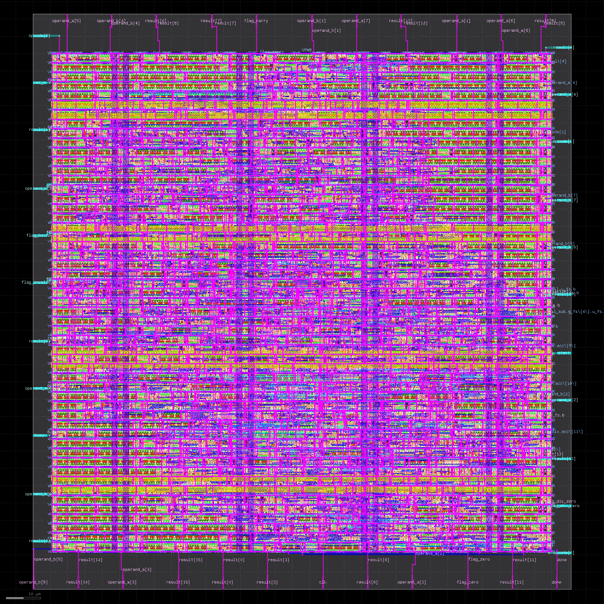
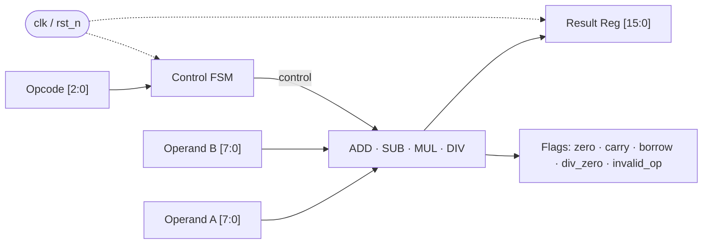
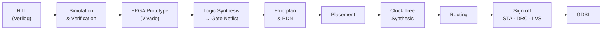
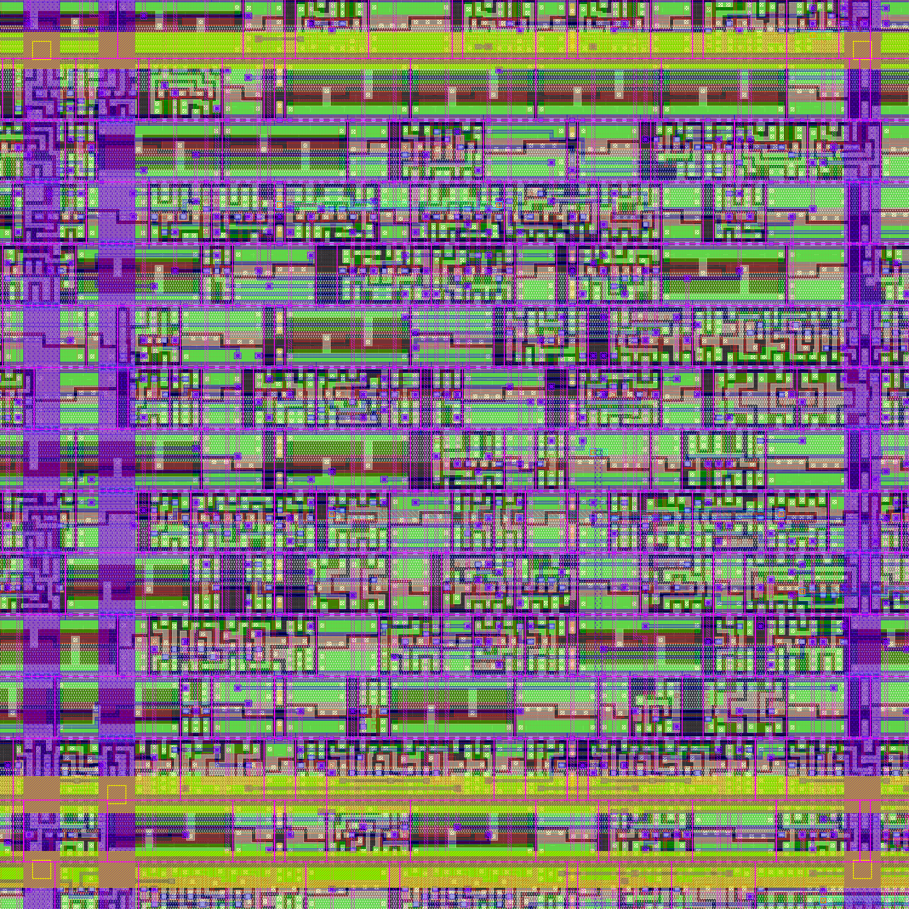
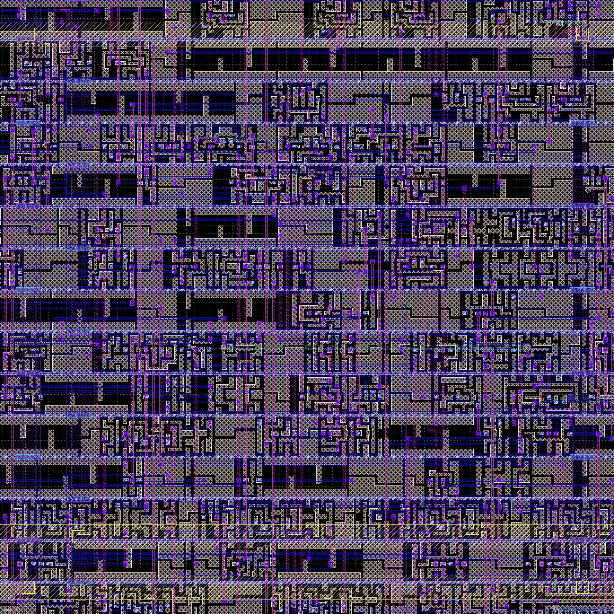
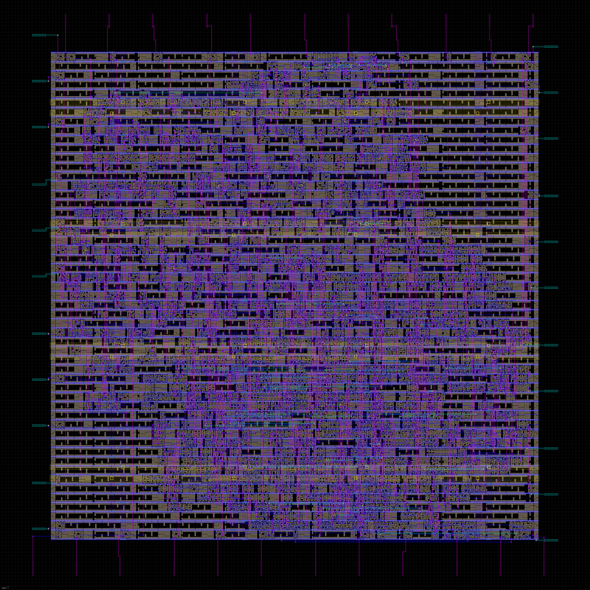

<div align="center">

# 🧮 8-Bit Calculator — RTL to GDSII

**A complete digital ASIC flow: behavioral Verilog → verified RTL → synthesized netlist → routed, sign-off-ready GDSII layout.**




</div>

---

## 📌 Overview

This repo takes a small **8-bit calculator (ALU + control FSM)** through the *entire* ASIC design flow, not just frontend RTL. Every stage — functional simulation, FPGA prototyping, logic synthesis, floorplanning, placement, clock tree synthesis, routing and physical sign-off — is documented with scripts, reports and layout snapshots, so the whole thing is reproducible.

**Why this project:** it's small enough to run the full flow end-to-end, but real enough to hit the actual physical design problems — power grid, congestion, clock skew, timing closure, DRC/LVS.

---

## 📐 Architecture

| Block | Role |
|-------|------|
| **Control FSM** | 2-state FSM (`IDLE`, `DIV`) with a `start` / `busy` / `done` handshake |
| **Adder / Subtractor / Multiplier** | Structural, combinational — built from full-adder and full-subtractor cells |
| **Restoring divider** | Sequential, 8 cycles |
| **Result register & flags** | 16-bit `result`, plus `zero`, `carry`, `borrow`, `div_zero`, `invalid_op` |



### Supported operations

| Category | Operations |
|----------|-----------|
| Arithmetic | `ADD` (`000`), `SUB` (`001`), `MUL` (`010`), `DIV` (`011`) |
| Invalid opcode | Any other opcode → `result = 0`, `invalid_op` flag set |
| Flags | `zero` · `carry` (ADD) · `borrow` (SUB, a < b) · `div_zero` (DIV by 0) · `invalid_op` |

---

## 🔁 Design Flow



### 1️⃣ RTL & Verification — [`01_RTL`](01_RTL) · [`03_Simulation`](03_Simulation)
Synthesizable Verilog for the ALU, control FSM and top module, plus a testbench that drives the opcodes and checks results and flags against expected values.

### 2️⃣ FPGA Prototype — [`02_Vivado`](02_Vivado)
Vivado project for FPGA-level synthesis, implementation and on-board sanity checking before committing to the ASIC flow.

### 3️⃣ Logic Synthesis — [`04_Synthesis`](04_Synthesis)
RTL is mapped onto standard cells from the target PDK, optimized for area, power and timing under the SDC constraints. Output: a gate-level netlist plus area/timing reports.

### 4️⃣ Floorplanning & Power Planning — [`05_Physical_GDSII`](05_Physical_GDSII)

<div align="center">
  
</div>

Core area, utilization and aspect ratio are set here, followed by the **Power Distribution Network**: `VDD`/`VSS` rings and stripes engineered to limit **IR drop** and **electromigration** so every cell sees a stable supply during switching.

### 5️⃣ Placement

<div align="center">
  
</div>

Standard cells are placed into rows, with connected cells pulled close together to cut wirelength, parasitic capacitance and delay.

### 6️⃣ Clock Tree Synthesis


Clock buffers/inverters are inserted so the clock reaches every flip-flop at nearly the same time, minimizing **skew** and avoiding setup/hold violations.

### 7️⃣ Routing

<div align="center">
  
</div>

Global and detailed routing across the metal stack (M1, M2, M3, …) connects every net while obeying the foundry's design rules.

### 8️⃣ Sign-off & GDSII
Final checks before tape-out: **STA** (setup/hold), **DRC**, **LVS** and parasitic extraction. The result is the **GDSII** — the polygon-level layout that maps directly to the fabrication masks.

---

## 📊 Results

| Metric | Value |
|--------|-------|
| Target PDK / node | SkyWater 130 nm (`sky130_fd_sc_hd`) |
| Clock frequency | 50 MHz (20 ns) |
| Cell count | 822 (post-synthesis) |
| Core area | ≈ 20,822 µm² (die ≈ 0.026 mm²) |
| Utilization | 40 % (core), 0.55 placement density |
| Setup slack (post-route) | +9.11 ns |
| Hold slack (post-route) | +0.33 ns |
| Total power (typical corner) | ≈ 0.61 mW |
| DRC violations | 0 |
| LVS | Clean |

---

## 🛠️ Tools

| Stage | Tool |
|-------|------|
| RTL / Simulation | Verilog HDL, Vivado Simulator (XSim) |
| FPGA | Xilinx Vivado 2024.2 (Artix-7 `xc7a35tcpg236-1`) |
| Logic Synthesis | Yosys (via OpenLane) |
| Place & Route | OpenLane (OpenROAD, TritonRoute) |
| Sign-off / Viewing | OpenSTA, Magic, Netgen, KLayout |
| PDK | SkyWater 130 nm (`sky130_fd_sc_hd`) |

---

## 📂 Repository Structure

```text
8-Bit-Calculator-RTL-GDSII/
├── 01_RTL/              # Verilog source (ALU, control FSM, top)
├── 02_Vivado/           # Vivado project for FPGA prototyping
├── 03_Simulation/       # Self-checking testbench (tb_calculator_top.v)
├── 04_Synthesis/        # Vivado utilization / timing / power reports
├── 05_Physical_GDSII/   # Final GDSII, DEF, OpenLane metrics, sign-off reports, layout renders
├── .gitignore
└── README.md
```

---

## ▶️ Getting Started

```bash
git clone https://github.com/ShamanSinghMultani/8-Bit-Calculator-RTL-GDSII.git
cd 8-Bit-Calculator-RTL-GDSII
```

**Simulate** — open the project in `02_Vivado` and run behavioral simulation with `tb_calculator_top` as the top module.

**FPGA** — in the same Vivado project, run synthesis → implementation.

**ASIC flow** — run OpenLane on the design (`./flow.tcl -design calculator_8bit`). Final outputs and reports are in `05_Physical_GDSII`.

---

## 🔮 Future Work

- Add signed arithmetic
- Pipeline the ALU and re-run timing closure at a higher clock
- Power analysis and area/timing trade-off sweeps across utilization targets
- Formal equivalence check between RTL and netlist

---

## 📄 License

Released under the [MIT License](LICENSE).

## 👤 Author

**Shaman Singh Multani** — B.Tech, Electronics Engineering (VLSI Design Technology), MAIT Delhi
[GitHub](https://github.com/ShamanSinghMultani)
